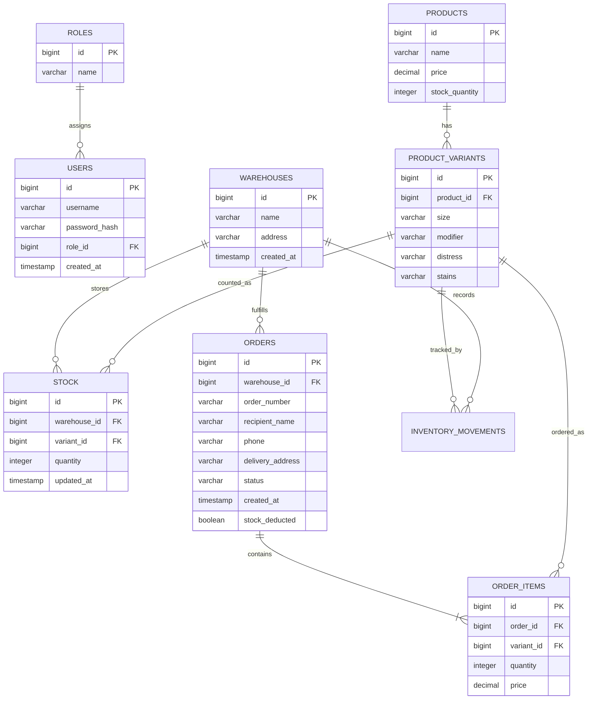

# Складской учёт товаров

Приложение складского учёта на Java 21, Spring Boot, Spring Security, Spring Data JPA/Hibernate, PostgreSQL и Thymeleaf. Помимо каталога товаров, приложение поддерживает остатки по вариантам, журнал складских движений и базовый цикл обработки заказов.

## Подготовка и запуск

1. Создайте базу PostgreSQL и настройте `spring.datasource.*` в `src/main/resources/application.properties`.
2. Запустите приложение:

```bash
mvn spring-boot:run
```

Откройте `http://localhost:8080`. Схема и демонстрационные записи инициализируются при старте. Инициализация не удаляет таблицы и пользовательские данные при перезапуске.

### Запуск вместе с PostgreSQL через Docker Compose

Docker Compose поднимает PostgreSQL с постоянным named volume и приложение, которое ждёт готовности базы перед запуском:

```bash
Copy-Item .env.example .env
# Установите локальный пароль в .env
docker compose up --build
```

После запуска приложение доступно на `http://localhost:8080`. Для сохранения данных не удаляйте volume `postgres_data`; `docker compose down -v` удаляет его вместе с данными.

### Проверки

```bash
mvn clean verify
```

PostgreSQL-интеграционные тесты запускают PostgreSQL 17 через Testcontainers. Для них нужен доступный Docker daemon; если он недоступен, тесты будут отмечены как skipped, а не как успешно проверенные. GitHub Actions выполняет тот же `mvn clean verify` на runner с Docker.

Для локальной демонстрации настроены пользователи:

| Пользователь | Пароль | Возможности |
| --- | --- | --- |
| `admin` | `admin123` | Все операции, журналы, аналитика |
| `manager` | `manager123` | Каталог, остатки и обработка заказов |

Это учебные in-memory учётные записи для локальной демонстрации, а не настройки для публичного развертывания. Таблицы `users` и `roles` являются частью ER-модели, но не участвуют в текущей Spring Security аутентификации.

## Страницы и API

- `/` — каталог с поиском, фильтром, сортировкой, пагинацией, CSV-экспортом и FAQ.
- `/products/new` — добавление товара.
- `/products/{id}/edit` — изменение товара.
- `/inventory` — остатки по вариантам и складам, приход/списание и журнал движений.
- `/products/{id}/variants` — варианты товара.
- `/orders` и `/orders/new` — список и создание заказов.
- `/audit` — журнал изменения цен, только ADMIN.
- `/creation-log` — журнал создания товаров, только ADMIN.
- `/analytics` — сводные показатели и товары с низким остатком, только ADMIN.
- `POST /api/faq` — локальный FAQ API. Принимает JSON вида `{"question":"Как добавить товар?"}` и возвращает `{"answer":"..."}`.

Создание заказа сохраняет снимок цены и не меняет складской остаток. Подтверждение атомарно проверяет доступность и списывает позиции, завершая заказ — оставляет списание, отменяя заказ до завершения — возвращает уже списанный остаток. ADMIN и MANAGER могут работать с каталогом, остатками и заказами; журналы и аналитика доступны ADMIN. Удаление товара доступно ADMIN, с защитой товаров, используемых в остатках, заказах или истории движений.

## PostgreSQL

- `log_price_change()` и триггер `product_price_change` записывают изменение цены в `audit_log`.
- `log_product_creation()` и триггер `product_creation` записывают вставку товара в `product_creation_log`.
- Приложение выполняет SELECT/INSERT/UPDATE/DELETE через Spring Data JPA; журналы изменений создаются триггерами, не Java-кодом.
- `stock` — источник складского остатка по паре склад/вариант; `products.stock_quantity` поддерживается как агрегат для каталога.
- `inventory_movements` хранит приход, списание, движения заказа и сверку начальных остатков.
- При первом запуске старые количества товаров переносятся на базовый вариант и записываются как начальные движения/сверка. Схема не удаляет существующие данные при повторном старте.
- Заказ связан со складом; его позиции ссылаются на вариант и хранят цену на момент оформления.
- `calculate_order_total(order_id)` — отдельная SQL-функция PostgreSQL, явно вызываемая приложением для расчёта суммы заказа по сохранённым ценам его позиций; сумма показывается в списке заказов и не меняется при последующем изменении цены товара.

## ER-модель для учебной системы

Основные сущности, которые должны присутствовать в схеме базы данных:



`audit_log`, `product_creation_log` и `inventory_movements` — служебные/операционные таблицы вне восьми основных сущностей учебной ER-модели.
